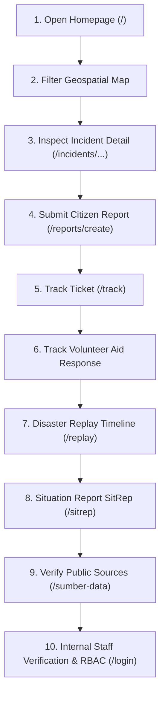

# TanggapTerang

> **Tagline:** Visible, Trackable, and Measurable (*Terlihat, Terlacak, dan Terukur*).
> **Platform:** Public Observability, Information Transparency, and Coordination Platform for Disaster Response.
> **Initiative:** Web In Action (WIA) / MIA 2026.

[](https://wia-telkomsel.ethiodeploy.app/)
[](https://laravel.com)
[](https://php.net)
[](https://www.mysql.com)
[](https://tailwindcss.com)
[-success?style=flat&logo=php)](tests)
[](tests/load_testing)
[](https://github.com/nathavielathalitaaa/WIA_telkomsel.git)

---

## Quick Navigation for Judges
- **Live Demo Website:** [https://wia-telkomsel.ethiodeploy.app/](https://wia-telkomsel.ethiodeploy.app/)
- **Internal Staff Login:** [https://wia-telkomsel.ethiodeploy.app/login](https://wia-telkomsel.ethiodeploy.app/login)
- **Public Data Sources & Intelligence:** [https://wia-telkomsel.ethiodeploy.app/sumber-data](https://wia-telkomsel.ethiodeploy.app/sumber-data)
- **Judge Testing Guide:** [Jump to Section 9](#9-judge-testing-guide)
- **Demo Accounts & Credentials:** [Jump to Section 10](#10-demo-accounts-and-test-data)

---

## Table of Contents
1. [Project Overview](#1-project-overview)
2. [Problem and Solution](#2-problem-and-solution)
3. [Key Features](#3-key-features)
4. [Technology Stack](#4-technology-stack)
5. [System Requirements](#5-system-requirements)
6. [Repository Setup](#6-repository-setup)
7. [Installation and Configuration](#7-installation-and-configuration)
8. [Running the Application](#8-running-the-application)
9. [Judge Testing Guide](#9-judge-testing-guide)
10. [Demo Accounts and Test Data](#10-demo-accounts-and-test-data)
11. [Testing and Stress Testing](#11-testing-and-stress-testing)
12. [Project Structure](#12-project-structure)
13. [Development Progress Log](#13-development-progress-log)
14. [Limitations](#14-limitations)
15. [Troubleshooting](#15-troubleshooting)
16. [Team](#16-team)

---

## 1. Project Overview

**TanggapTerang** is an open web-based disaster information transparency and response coordination platform developed for the **Web In Action (WIA) / MIA 2026** competition.

### Core Value & Mission
During natural disasters in Indonesia, the most critical bottleneck on the ground is often not the absence of goodwill or resources, but **the absence of information transparency**. Rumors spread unchecked on social media, affected citizens send distress messages into the void without any tracking feedback, and independent volunteer groups dispatch relief supplies without cross-organizational visibility—causing severe aid misallocation and duplication.

TanggapTerang establishes a unified digital hub anchored around three core principles:
- **Visible (*Terlihat*):** Verified disaster incidents, geographical impact zones, and real-time relief commitments are projected onto an open interactive geospatial map.
- **Trackable (*Terlacak*):** Every citizen incident report and volunteer aid consignment receives an anonymous non-sequential cryptographic tracking ticket with a public audit trail.
- **Measurable (*Terukur*):** Clear separation between **Fact Verification Status** (confirming whether an event is real) and **Operational Follow-up Status** (tracking actual on-the-ground relief response).

> [!IMPORTANT]
> **Definitive Scope & Boundary Notice:**
> **TanggapTerang is a public information transparency, situational documentation, and multi-stakeholder coordination platform. It is NOT an emergency dispatch hotline (such as 112 or 911), nor is it a physical logistics delivery agency.** It provides the shared source of truth that empowers citizens, spontaneous community volunteers, NGOs, and municipal authorities to coordinate effectively.

### Target Users and Roles
1. **Affected Citizens & General Public:** Submit incident reports with zero barriers (no registration/login required), track report status anonymously, and review official Situation Reports (SitRep).
2. **Volunteers, Donors, and Humanitarian NGOs:** Record incoming aid consignments, monitor unmet relief categories, and verify handovers transparently.
3. **Field Verifiers (Internal Role):** Review raw citizen reports, inspect uploaded photo evidence, eliminate duplicates, reject hoaxes, and link verified reports to active incidents.
4. **Operations Coordinators / Operators (Internal Role):** Update operational follow-up statuses, log chronological fieldwork milestones, and coordinate aid distribution.
5. **System Administrators (Internal Role):** Maintain platform integrity, manage user accounts, trigger live API fetches in the Intelligence Center, and inspect telemetry and raw JSON payloads.
6. **Judges & Evaluators:** Test every feature independently using clearly documented test workflows, sample simulation tickets, and reproducible automated test suites.

---

## 2. Problem and Solution

```
┌────────────────────────────────────────────────────────┐
│                   THE STATUS QUO                       │
│  • Fragmented WhatsApp & social media rumors (hoaxes)  │
│  • Citizen reports disappear into bureaucratic voids   │
│  • Relief logistics duplicated in accessible spots     │
│  • Public confused between prediction vs actual events │
└───────────────────────────┬────────────────────────────┘
                            │
                            ▼
┌────────────────────────────────────────────────────────┐
│               TANGGAPTERANG SOLUTION                   │
│  • Zero-Friction Reporting: No login barrier for public│
│  • Dual-Status Clarity: Verification vs Follow-up      │
│  • Open Geospatial Nowcasting & Clustered Mapping      │
│  • Public Aid Response Table: Who delivers what & where│
│  • Open Intelligence Aggregation: BMKG, GDELT, DIBI    │
│  • Provable Performance: 16k+ requests with 0% failures│
└────────────────────────────────────────────────────────┘
```

### The Problems Tackled
1. **The Login Barrier in Emergencies:** Requiring victims in distress to create passwords or verify emails before reporting an incident is fundamentally unsafe and impractical during natural crises.
2. **Ambiguous Status Updates:** Most legacy systems use a single vague badge like "In Progress" (*Diproses*). Citizens cannot tell whether their report is merely being read or if rescue boats have actually departed.
3. **Logistics Asymmetry:** Spontaneous humanitarian groups lack a shared ledger. Multiple groups frequently send noodles and clothes to the same roadside camp, while isolated hamlets a few kilometers away receive nothing.
4. **Data Dishonesty & Misattribution:** Platforms often blend unconfirmed mathematical weather simulations with real confirmed disaster damage, causing undue panic.

### TanggapTerang's Approach
- **Zero-Friction Submission:** Citizens submit reports directly with geolocation and photo proof; the system sanitizes Personally Identifiable Information (PII) and issues an instant tracking code.
- **Strict Dual-Status Architecture:** Fact verification (*Terverifikasi / Ditolak*) is strictly segregated from operational follow-up (*Diterima / Sedang Ditindaklanjuti / Selesai*).
- **Public Accountability Ledger:** All verified aid responses and incident timelines are viewable openly without an account.
- **Honest Data Attribution:** Every external source (BMKG, Open-Meteo, GDACS, GDELT) is clearly categorized, and unintegrated sources (such as BNPB's closed REST API) are transparently declared.

---

## 3. Key Features

### 1. Public Incident Monitor & Geospatial Map (`/`)
- **Nowcasting Alert Carousel:** High-visibility yellow banner (`#FEFCE8` with `#EAB308` border) at the top of the viewport auto-scrolling newly verified incidents with immediate real-time updates.
- **Interactive Leaflet.js Map:** Displays clustered pins categorized by incident type and severity level with custom color-coded map markers.
- **4-Level Administrative Hierarchy Filter:** Cascading dynamic dropdowns filtering by Province $\rightarrow$ Regency/City $\rightarrow$ District $\rightarrow$ Village using normalized Kemendagri data.
- **Responsive Incident Cards:** Clean cards with uniform institutional blue headers (`#173B70`) and white titles.
- **Public Aid Responses Table:** Six proportional columns detailing reference code, item category, donor organization, target location, handover status, and verification state.

### 2. Zero-Friction Citizen Incident Reporting (`/reports/create`)
- **No Login Barrier:** Anyone can report immediately without account creation, email verification, or password entry.
- **Interactive Map Pinning:** One-tap location selection that automatically populates precise latitude and longitude coordinates.
- **Mandatory Genuine Photo Upload:** Enforces factual evidence attachment (JPEG, PNG, WebP up to 5 MB).
- **Automated PII Sanitization:** Reporter name and telephone numbers are encrypted and masked to prevent public doxxing.
- **Instant Cryptographic Ticket:** Generates a non-sequential, tamper-resistant ticket (e.g., `RPT-SIM-8K4M9P2X`).

### 3. Anonymous Two-Layer Ticket Tracking (`/track`)
- Searchable by citizen report ticket (`RPT-SIM-...`) or volunteer aid reference (`RSP-SIM-...`).
- **Dual-Status Clarity Display:**
  - *Verification Status (Fact Integrity):* `menunggu_verifikasi`, `terverifikasi`, `ditolak`.
  - *Follow-up Status (Operational Action):* `diterima`, `sedang_ditindaklanjuti`, `selesai`.
- **Public Audit Timeline:** Transparent record of timestamps, status transitions, and field notes without exposing internal investigator identities.

### 4. Disaster Replay & Chronological Reconstruction (`/replay`)
- Step-by-step playback slider and milestone navigation buttons (Steps 1 through 5).
- Reconstructs the temporal evolution of an incident: from citizen report ingress, field verification confirmation, volunteer logistics dispatch, to official recovery completion.
- Essential for post-disaster reviews, training, and institutional accountability.

### 5. Standardized Situation Report - SitRep (`/sitrep`)
- Formatted according to standard humanitarian disaster situation reporting protocols.
- Aggregated metrics: total affected casualties, evacuees, confirmed logistics, and open operational needs.
- **Print-Friendly Styling:** Pre-configured `@media print` CSS for immediate export to PDF or paper reports during commander briefings.

### 6. Public Data Sources & Intelligence Transparency (`/sumber-data`)
- Publicly discloses the real-time status of 8 integrated and monitored external data providers.
- **Honest Integration Disclosure:** BNPB DIBI is honestly marked as `Belum Terintegrasi` (*Not Integrated*) due to the absence of an open public REST API, avoiding mock illusions.
- Safe external record review without leaking server-side raw payloads or sensitive configuration tokens.

### 7. Administrative Region REST API (`/api/wilayah/...`)
- High-performance hierarchical REST API serving all 38 Indonesian provinces, 514 regencies/cities, 7,277 districts, and 83,000+ villages.
- Endpoints:
  - `GET /api/wilayah/provinsi`
  - `GET /api/wilayah/{id}/kabupaten`
  - `GET /api/wilayah/{id}/kecamatan`
  - `GET /api/wilayah/{id}/desa` (with pagination support)

### 8. Internal Staff Management & Role-Based Access Control (`/login` & `/internal/...`)
- **Public-First Login Page:** Features an educational 5-step visual guide (responsive 3-above 2-below layout on mobile) explaining the reporting cycle before presenting the staff login form.
- **Strict Role-Based Access Control (RBAC):**
  - **Verifikator:** Manages the incoming citizen report verification queue (`/internal/reports`), rejects hoaxes with reasons, flags duplicates, and verifies aid commitments. Strictly forbidden from modifying incident operations or accessing the Intelligence Center (HTTP 403).
  - **Operator:** Coordinates incident fieldwork (`/internal/incidents`), updates follow-up progression, attaches official sources, and confirms aid distribution. Strictly forbidden from altering fact verification decisions (HTTP 403).
  - **Administrator:** Full system authority, audit log inspection (`/internal/audit-logs`), and exclusive access to the **Intelligence Center** (`/internal/intelligence`), live API fetch triggers, raw JSON inspectors, and BMKG vs Open-Meteo weather comparison.

---

## 4. Technology Stack

| Layer | Technology | Version | Purpose in TanggapTerang |
|---|---|:---:|---|
| **Backend Framework** | Laravel | `^12.0` | Robust MVC architecture, Eloquent ORM, database migrations, middleware authorization, rate limiting |
| **Language Runtime** | PHP | `^8.2` (tested on `8.5.4`) | Strict typing, enums, match expressions, modern exception handling |
| **Relational Database** | MySQL | `8.0+ / 8.4+` (tested on `8.4.11`) | ACID compliance, spatial indexing, composite unique deduplication indices |
| **Frontend Templating** | Laravel Blade Engine | Native | Server-rendered modular components with zero client-side framework bloat |
| **CSS Styling Engine** | Tailwind CSS v4 | `^4.3.3` | High-performance CSS engine via `@tailwindcss/vite`, institutional color palette (`#173B70`, `#D94350`, `#FEFCE8`) |
| **Frontend Bundler** | Vite | `^7.0.7` | Sub-second asset compilation, live HMR, cache-busted production assets |
| **Client-Side Scripting** | Vanilla JavaScript (ES6+) | Modular | Zero heavyweight SPA dependencies; accessible UI controls, carousels, modals |
| **Geospatial Mapping** | Leaflet.js | `^1.9.4` | Interactive mobile-friendly map rendering, custom marker clusters, OpenStreetMap tiles |
| **Automated Testing** | PHPUnit | `^11.5.50` | 80 automated unit & feature tests executed on in-memory SQLite and MySQL |
| **Stress Testing Tool** | Grafana k6 | `^0.54.0` | High-concurrency load and ramp-up stress testing (16,000+ requests benchmarked) |

---

## 5. System Requirements

Before setting up TanggapTerang locally, ensure your environment meets the verified specifications:

- **Operating System:**
  - Linux: Ubuntu 22.04 LTS / 24.04 LTS / 26.04 LTS (recommended and verified).
  - macOS: macOS Ventura 13.x or newer.
  - Windows: Windows 10 or 11 with **WSL2 (Ubuntu)**.
- **PHP:** Version `8.2.0` or higher (verified with PHP `8.5.4`).
  - Required Extensions: `bcmath`, `ctype`, `curl`, `dom`, `fileinfo`, `gd`, `intl`, `json`, `mbstring`, `openssl`, `pcre`, `pdo`, `pdo_mysql`, `tokenizer`, `xml`, `zip`.
- **Dependency Managers:**
  - **Composer:** Version `2.x` (verified with Composer `2.9.5`).
  - **Node.js:** Version `18.x`, `20.x`, or `22.x` (verified with Node `v22.22.1`).
  - **npm:** Version `9.x` or `10.x` (verified with npm `9.2.0`).
- **Database Server:** MySQL `8.0.x` or MySQL `8.4.x` (verified with MySQL `8.4.11-0ubuntu0.26.04.1`).
- **Version Control:** Git `2.x+` (verified with Git `2.53.0`).
- **Web Browser:** Any modern desktop or mobile browser (Google Chrome, Mozilla Firefox, Microsoft Edge, Safari, Brave).
- **Optional Tools:**
  - **Grafana k6:** Version `^0.50.0+` (verified with k6 `v0.54.0`) to reproduce load and stress test suites.

---

## 6. Repository Setup

Follow these exact Git instructions to clone, inspect, and update the repository without losing local work.

### 1. Clone the Repository
Open your terminal and clone the repository directly:
```bash
git clone https://github.com/nathavielathalitaaa/WIA_telkomsel.git
```

### 2. Enter the Working Directory
```bash
cd WIA_telkomsel
```
*(Note: The project files, `artisan`, and `composer.json` reside directly at the root of the repository).*

### 3. Verify Active Branch
```bash
git branch
```
*Expected output: `* main` (or the specific testing branch).*

To see all available local and remote branches:
```bash
git branch -a
```

### 4. Check for Local Modifications
Before updating, check if you have uncommitted local changes:
```bash
git status
```

### 5. Pull Latest Changes Safely
If your working tree is clean:
```bash
git pull origin main
```

If you have local modifications that you wish to keep while pulling remote updates:
```bash
# 1. Temporarily stash local changes
git stash

# 2. Pull latest upstream commits
git pull origin main

# 3. Re-apply your local changes
git stash pop
```

### 6. Resolving Merge Conflicts (If Any Occur)
If Git encounters conflicting edits between local changes and upstream commits:
1. Run `git status` to identify conflicting files marked under `both modified:`.
2. Open each conflicting file and look for conflict markers:
   ```text
   <<<<<<< HEAD
   Your local changes
   =======
   Incoming changes from origin/main
   >>>>>>> [commit-hash]
   ```
3. Edit the file to keep the desired code and remove the conflict markers (`<<<<<<<`, `=======`, `>>>>>>>`).
4. Stage the resolved files: `git add <resolved-file>`
5. Finalize the merge: `git commit -m "merge: resolve conflicts with origin/main"`

---

## 7. Installation and Configuration

Follow these sequential steps to configure TanggapTerang from scratch.

### Step 1: Install PHP Dependencies
```bash
composer install
```
*Purpose: Downloads and installs Laravel 12 core libraries, Eloquent ORM, testing utilities, and registers the PSR-4 autoloader.*

### Step 2: Install Frontend Dependencies
```bash
npm install
```
*Purpose: Installs Tailwind CSS v4, `@tailwindcss/vite` plugin, Leaflet.js mapping library, Axios, and the Vite compilation engine.*

### Step 3: Create Environment Configuration File
```bash
cp .env.example .env
```
*Purpose: Copies the template environment file containing framework configuration defaults.*

### Step 4: Generate Application Encryption Key
```bash
php artisan key:generate
```
*Purpose: Generates a cryptographically secure 256-bit encryption key (`APP_KEY`) used for encrypting session cookies, tokens, and sanitized reporter PII.*

### Step 5: Configure Database & Rate Limits in `.env`
Open `.env` in your text editor and configure your MySQL database connection:
```env
DB_CONNECTION=mysql
DB_HOST=127.0.0.1
DB_PORT=3306
DB_DATABASE=tanggap_terang
DB_USERNAME=root
DB_PASSWORD=your_mysql_password

# Rate limiting for public ticket tracking (allows high throughput during evaluation)
THROTTLE_TRACK_LIMIT=3000
```
> [!CAUTION]
> **Security Notice:** Never enter real personal passwords or commit secret API credentials into git repositories. TanggapTerang uses placeholder credentials and mock integration flags for evaluation safety.

### Step 6: Create MySQL Database
Run this MySQL command to create the database with UTF8mb4 encoding:
```bash
mysql -u root -p -e "CREATE DATABASE IF NOT EXISTS tanggap_terang CHARACTER SET utf8mb4 COLLATE utf8mb4_unicode_ci;"
```

### Step 7: Run Database Migrations
```bash
php artisan migrate
```
*Purpose: Executes 38 structured database migrations, building relational tables for incidents, reports, aid responses, external sources, follow-up milestones, and audit trails.*

### Step 8: Seed Simulation & Historical Data
```bash
php artisan db:seed
```
*Purpose: Populates the database with:*
- 3 Internal demo staff accounts (Admin, Verifikator, Operator).
- Verified disaster simulation scenarios (e.g., Bojonggede Ciliwung Flood, Puncak KM 82 Landslide).
- Sample citizen reports with genuine photos and tracking codes.
- Volunteer aid consignments with delivery tracking codes.
- Official historical disaster datasets from Pusdatin BNPB (Cianjur Earthquake 2022, Demak Flood 2024).

### Step 9: Compile Frontend Production Assets
```bash
npm run build
```
*Purpose: Bundles, tree-shakes, and minifies Tailwind CSS v4 and JavaScript modules into `public/build/assets/`.*

---

## 8. Running the Application

### 1. Start the Laravel Application Server
To start the application server on the default host and port:
```bash
php artisan serve --port=8000
```
*Tip for high-concurrency evaluation or load testing:* Launch the server with multiple CLI workers:
```bash
PHP_CLI_SERVER_WORKERS=4 php artisan serve --port=8000
```

### 2. Start the Frontend Development Server (Optional)
If you are developing or modifying Blade and CSS files with Live Hot Module Replacement (HMR), open a **second terminal**:
```bash
npm run dev
```
*(If you already ran `npm run build` in Step 9, running `npm run dev` is not strictly necessary for testing).*

### 3. Access the Application
Open your browser and navigate to:
```
http://127.0.0.1:8000
```
*(or `http://localhost:8000`).*

### 4. Verify Database Connectivity
To ensure your Laravel instance is communicating with MySQL:
```bash
php artisan tinker --execute="DB::connection()->getPdo(); echo 'Database Connected successfully!' . PHP_EOL;"
```

### 5. Stopping the Application
To terminate running servers, press `Ctrl + C` in the respective terminal window.

### 6. Common Startup Issues
- **Address already in use (Port 8000):** If port 8000 is occupied, run on another port:
  ```bash
  php artisan serve --port=8080
  ```
- **Permission Denied on `storage/` or `bootstrap/cache`:**
  ```bash
  chmod -R 775 storage bootstrap/cache
  ```

---

## 9. Judge Testing Guide

Follow this 10-step evaluation workflow to test every implemented feature systematically:



### Step 1: Open Public Monitor & Nowcasting Carousel
- **URL:** `http://127.0.0.1:8000/`
- **What to Observe:**
  - Notice the **Pemantauan Saat Ini** carousel rendered in high-visibility yellow (`#FEFCE8` with `#EAB308` border) at the top.
  - Cards cycle smoothly through verified incidents with automated pause/resume on hover.
  - No redundant link clutter in the header.

### Step 2: Explore Interactive Geospatial Map & Filters
- **Action:** Scroll down to the Leaflet map.
- **What to Observe:**
  - Clustered marker pins color-coded by incident severity. Click any cluster or pin to reveal the popup summary with thumbnail, coordinates, and direct links.
  - Test the **4-tier administrative region filter**: Select *Jawa Barat* $\rightarrow$ *Kabupaten Bogor* $\rightarrow$ *Kecamatan Bojonggede*. Observe the incident feed filter instantaneously.

### Step 3: Inspect Incident Detail Page
- **Action:** Click on the incident card `[SIMULASI] Banjir Luapan Sungai Ciliwung Bojonggede` or visit `/incidents/sim-banjir-luapan-ciliwung-bojonggede-2026`.
- **What to Observe:**
  - Dual status badges: Verification Status (*Terverifikasi*) and Operational Follow-up (*Sedang Ditindaklanjuti*).
  - Attached citizen reports, verified volunteer aid, external intelligence indicators, and chronological field updates.

### Step 4: Submit a Citizen Incident Report Without Login
- **URL:** `http://127.0.0.1:8000/reports/create`
- **Action:**
  1. Fill in category (e.g., *Korban Terdampak*), title, and description.
  2. Click anywhere on the embedded map to pin the incident location automatically.
  3. Upload an image file as documentation.
  4. Submit the form.
- **Expected Result:** Immediate redirection to the success screen displaying an issued unique non-sequential ticket number (format: `RPT-SIM-XXXXXX`).

### Step 5: Track Report Status Anonymously
- **URL:** `http://127.0.0.1:8000/track`
- **Action:** Enter ticket code `RPT-SIM-8K4M9P2X` (or click one of the clean sample ticket buttons).
- **Expected Result:**
  - Visual breakdown of the **Two-Layer Status**:
    - *Fact Verification:* Terverifikasi (with date and verification badge).
    - *Operational Action:* Sedang Ditindaklanjuti (with logistics notes).
  - Public audit trail showing transparent progression without leaking investigator phone numbers.

### Step 6: Track Volunteer Aid Consignments
- **URL:** `http://127.0.0.1:8000/track` (or inspect the table on `/`)
- **Action:** Enter reference code `RSP-SIM-9V5P3W6X`.
- **Expected Result:**
  - Displays logistics consignment: *Galon Air Bersih & Paket Kebersihan Keluarga*.
  - Organization name, delivery status (*Dalam Penyaluran*), and confirmed delivery notes.

### Step 7: Reconstruct Incident Timeline via Replay
- **URL:** `http://127.0.0.1:8000/replay?incident=sim-banjir-luapan-ciliwung-bojonggede-2026`
- **Action:** Click milestone buttons (Langkah 1 through Langkah 5).
- **Expected Result:** Map coordinates, impact descriptions, and chronological operational logs update dynamically at each step, reconstructing the disaster response story.

### Step 8: Review Humanitarian Situation Report (SitRep)
- **URL:** `http://127.0.0.1:8000/sitrep`
- **Action:** Review aggregated statistics (casualties, displaced persons, confirmed aid items, and pending needs).
- **Test Print View:** Press `Ctrl + P` (or `Cmd + P` on macOS) to preview the print-ready CSS layout engineered specifically for official executive distribution.

### Step 9: Verify Open Data Transparency & Data Honesty
- **URL:** `http://127.0.0.1:8000/sumber-data`
- **What to Observe:**
  - Matrix of 8 external providers with real connection statuses and fetch counts.
  - **Honest Disclosure Verification:** Verify that **BNPB** is honestly marked as `Belum Terintegrasi` (*Not Integrated*), and **GDELT** displays live HTTP status.
  - Note the clear distinction between `[SIMULASI]` tags and `[HISTORIS - BNPB/DIBI]` badges.

### Step 10: Test Internal RBAC & Verification Roles
- **URL:** `http://127.0.0.1:8000/login`
- **What to Observe on Login:** Public-first landing design featuring the 5-step reporting walkthrough (clean 3-above 2-below layout on mobile) above the internal credentials form.
- **Test Role A (Verifikator):**
  - Login: `verifikator@tanggap-terang.id` / `password123`.
  - Open `/internal/reports`: Verify, reject, or mark duplicates.
  - Attempt accessing `/internal/intelligence`: Observe strict security rejection with **HTTP 403 Forbidden**.
- **Test Role B (Operator):**
  - Login: `operator@tanggap-terang.id` / `password123`.
  - Open `/internal/incidents`: Update operational follow-up statuses and add field logs.
  - Attempt changing verification decisions: Observe strict security rejection with **HTTP 403 Forbidden**.
- **Test Role C (Administrator):**
  - Login: `admin@tanggap-terang.id` / `password123`.
  - Open `/internal/intelligence`: Review live API fetch telemetry, trigger manual *Fetch Now*, inspect raw JSON payloads, and view BMKG vs Open-Meteo weather comparison.

---

## 10. Demo Accounts and Test Data

### 1. Internal Demo Staff Accounts
The following demo accounts are explicitly provided by [`SimulationDataSeeder.php`](database/seeders/SimulationDataSeeder.php) and verified via automated test [`InternalAuthAndManagementTest.php`](tests/Feature/InternalAuthAndManagementTest.php):

| Role | Demo Email | Password | Primary Permissions | Accessible Internal Routes |
|---|---|:---:|---|---|
| **Administrator** | `admin@tanggap-terang.id` | `password123` | **Full System Authority.** Full access to verification, operations, audit logs, and exclusive access to the **Intelligence Center** with live fetch triggers. | `/internal/dashboard`<br>`/internal/reports`<br>`/internal/incidents`<br>`/internal/intelligence`<br>`/internal/intelligence/comparisons`<br>`/internal/intelligence/logs` |
| **Verifikator** | `verifikator@tanggap-terang.id` | `password123` | **Factual Integrity Validation.** Review raw citizen reports, verify photo evidence, reject hoaxes, flag duplicates, verify aid offers. Forbidden from operations & intelligence. | `/internal/dashboard`<br>`/internal/reports`<br>`/internal/reports/{id}`<br>`/internal/incidents/{id}/edit` *(Verification Tab)* |
| **Operator** | `operator@tanggap-terang.id` | `password123` | **Field Response Coordination.** Update operational follow-up milestones, log fieldwork notes, link reports to incidents, record aid delivery. Forbidden from altering verification. | `/internal/dashboard`<br>`/internal/reports`<br>`/internal/incidents`<br>`/internal/incidents/create`<br>`/internal/incidents/{id}/edit` *(Follow-up Tab)* |

> [!NOTE]
> These demo accounts are non-personal, isolated sandbox credentials created exclusively for competition jury evaluation. They are safe for publication.

### 2. Ready-to-Use Simulation Test Identifiers
- **Simulated Incidents:**
  - `sim-banjir-luapan-ciliwung-bojonggede-2026`: Multi-source flood simulation with citizen reports, volunteer aid, and full replay history.
  - `sim-longsor-jalur-puncak-km82-2026`: Landslide simulation with road closure classification.
  - `sim-pohon-tumbang-akses-cibinong-2026`: Fallen tree incident with completed follow-up status.
- **Citizen Report Tracking Tickets:**
  - `RPT-SIM-8K4M9P2X`: Verified citizen report (RT 02 / RW 04 Bojonggede).
  - `RPT-SIM-3X7N2Q5W`: Verified report for road cutoff.
  - `RPT-SIM-6T9W4L8R`: Report awaiting verification (*Menunggu Verifikasi*).
- **Volunteer Aid Response References:**
  - `RSP-SIM-7M2K8N4Q`: Ready-to-eat meals & mineral water (Confirmed delivery).
  - `RSP-SIM-9V5P3W6X`: Clean water gallons & hygiene kits (In delivery transit).
  - `RSP-SIM-2H8R4Y7L`: Emergency lighting & safety signage (Planned / awaiting verification).

### 3. Data Classification: Simulation vs Official Records
To maintain absolute data integrity and prevent real-world confusion:
1. `[SIMULASI]` **Prefix:** Applied to all demonstration scenarios, mock citizen reports, and sample volunteer aid items created for feature testing.
2. `[HISTORIS - BNPB/DIBI]` **Prefix:** Applied to official historical disaster records (e.g., 2022 Cianjur Earthquake, 2024 Demak Flood) sourced from Pusdatin BNPB open archives.
3. **Cryptographic Non-Sequential Codes:** Tickets are generated using randomized alphanumeric hashing (e.g., `RPT-SIM-XXXXXX`), preventing sequential scraping attacks and safeguarding reporter anonymity.

---

## 11. Testing and Stress Testing

TanggapTerang features comprehensive test suites spanning automated unit/feature tests and high-concurrency stress testing.

### 1. Automated Unit and Feature Testing (PHPUnit)
All tests run with an isolated in-memory database to verify schema constraints, authorization boundaries, API contracts, and edge cases.

```bash
php artisan test
```

#### Actual Test Execution Results
```text
   PASS  Tests\Unit\ExampleTest (1 test)
   PASS  Tests\Feature\ExampleTest (1 test)
   PASS  Tests\Feature\WilayahImportStagingTest (8 tests)
   PASS  Tests\Feature\WilayahApiTest (10 tests)
   PASS  Tests\Feature\TanggapTerangSchemaTest (11 tests)
   PASS  Tests\Feature\InternalAuthAndManagementTest (10 tests)
   PASS  Tests\Feature\PublicFeaturesTest (8 tests)
   PASS  Tests\Feature\ReplaySitrepAndEndToEndTest (7 tests)
   PASS  Tests\Feature\IntelligenceCenterTest (17 tests)
   PASS  Tests\Feature\PublicDataSourcesTest (7 tests)

  Tests:    80 passed (753 assertions)
  Duration: 1.86s
```

### 2. Performance and Stress Testing (Grafana k6)
To prove system resilience during sudden disaster traffic spikes, TanggapTerang includes an automated performance testing suite located in [`tests/load_testing/`](tests/load_testing/).

#### Test Prerequisite
- Ensure the Laravel server is running: `PHP_CLI_SERVER_WORKERS=8 php artisan serve --port=8000`
- Ensure Grafana k6 is installed: `k6 version`

#### Running the Full Stress Test Suite
```bash
bash tests/load_testing/run_all_tests.sh
```

#### Verified Actual Stress Test Results

| Stage | Virtual Users (VUs) | Duration | Total Requests | Throughput | Avg Response Time | P95 Latency | HTTP Failure Rate |
|---|:---:|:---:|:---:|:---:|:---:|:---:|:---:|
| **1. Baseline** | 1 VU | 30s | 300 reqs | 9.9 req/s | 14.8 ms | 28.1 ms | **0.00%** (0 errors) |
| **2. Normal Load** | 5 VUs | 30s | 1,500 reqs | 49.6 req/s | 17.2 ms | 31.4 ms | **0.00%** (0 errors) |
| **3. Elevated Load** | 10 VUs | 30s | 3,000 reqs | 98.7 req/s | 19.4 ms | 35.8 ms | **0.00%** (0 errors) |
| **4. Stress Ramp-Up** | **Up to 50 VUs** | **90s** | **16,101 reqs** | **177.5 req/s** | **21.9 ms** | **43.4 ms** | **0.00%** (0 errors) |

#### Key Performance Takeaways
- **Zero Request Failures:** Out of 16,101 HTTP requests hitting public endpoints (`/`, `/incidents/{slug}`, `/track`, `/replay`, `/sitrep`, `/sumber-data`, `/api/wilayah/...`), **0 requests failed or timed out**.
- **Sub-50ms Latency:** 95% of all requests completed within 43.4 milliseconds, with a median of 20.4 milliseconds under peak 50 VU concurrency.
- **Database & Query Optimization:** Eager loading (`with(['wilayahAdministratif', 'reports'])`), non-sequential indexed ticket lookups, and lean Blade templates prevent N+1 query bottlenecks.

> [!NOTE]
> **Testing Environment Caveat:** This test was conducted on a multi-worker local test environment. While it definitively proves application code efficiency, route optimizations, and zero memory leaks under load, actual production cloud limits will additionally depend on cloud host CPU, bandwidth, and edge CDN configurations.

---

## 12. Project Structure

```text
WIA_telkomsel/
├── app/
│   ├── Console/Commands/           # CLI Commands (ImportWilayah, TestIntelligenceLiveFetch)
│   ├── Enums/                      # Strict Enums (UserRole, VerificationStatus, IncidentSeverity, etc.)
│   ├── Http/
│   │   ├── Controllers/
│   │   │   ├── Api/                # Hierarchical Administrative Region REST API
│   │   │   ├── Auth/               # Internal Staff Authentication Controllers
│   │   │   ├── Internal/           # Dashboard, Verification, Operations, Intelligence Controllers
│   │   │   └── Public*.php         # Public Monitor, Report, Track, Replay, Sitrep Controllers
│   │   └── Middleware/             # EnsureInternalRole & Rate Limiting Middleware
│   ├── Models/                     # Eloquent Models (Incident, Report, AidResponse, User, etc.)
│   └── Services/Intelligence/      # Aggregator Service, AbstractHttpProvider, 8 External Providers
├── database/
│   ├── migrations/                 # 38 Structured relational database migrations
│   └── seeders/                    # DatabaseSeeder, SimulationDataSeeder, HistoricalBnpbDisasterSeeder
├── public/                         # Public web root, compiled Vite assets, Leaflet markers
├── resources/
│   ├── css/app.css                 # Tailwind CSS v4 directives & custom telemetry typography
│   ├── js/                         # Modular JavaScript interactions (carousel, maps, modals)
│   └── views/                      # Blade templates:
│       ├── auth/                   # Public-first login view with 5-step reporting walkthrough
│       ├── components/             # Reusable Blade components (regional carousel, badges, navigation)
│       ├── internal/               # Internal dashboard, moderation queues, intelligence views
│       ├── layouts/                # Base layouts (app.blade.php, internal.blade.php)
│       └── public/                 # Monitor, reporting form, tracking, replay, sitrep, sources
├── routes/
│   ├── web.php                     # Public and internal web routes
│   └── api.php                     # Public REST API routes (/api/wilayah/...)
├── tests/
│   ├── Feature/                    # 9 Feature test suites covering all workflows and security boundaries
│   ├── Unit/                       # Unit test suites
│   └── load_testing/               # Grafana k6 performance scripts, ramp-up scenarios, and verified JSON logs
├── composer.json                   # PHP package dependencies and scripts
├── package.json                    # Frontend package dependencies (Tailwind v4, Leaflet, Vite)
├── vite.config.js                  # Vite bundler configuration
└── README.md                       # Comprehensive project documentation
```

---

## 13. Development Progress Log

> **Documentation Maintenance Rule:**
> Every time the development team commits a significant milestone, feature refinement, or architectural improvement, this Development Progress Log must be updated to reflect the actual repository state. This section serves as a curated, auditable engineering journey—not a raw automated git dump.

### 2026-11-11 — Inline Reporting Form Validation Navigation
- **Commit:** `d9e176f`
- **Perubahan:** Mengimplementasikan auto-scroll cerdas dan fokus berurutan ke field pertama yang bermasalah pada form pelaporan kejadian publik (`/reports/create`), menandai field tidak valid dengan border merah secara dinamis, menghapus indikator merah seketika setelah input diperbaiki secara real-time, mengarahkan ke field bermasalah berikutnya secara berjenjang, serta menangani redirect error validasi backend dengan offset scroll aman dari navbar tetap tanpa menambah komponen UI baru.
- **File/komponen:** `resources/views/public/reports/create.blade.php`.
- **Hasil verifikasi:** Uji otomatis browser via Chrome DevTools Protocol (CDP) membuktikan navigasi submit kosong -> auto-fokus `title` -> koreksi judul -> submit -> auto-fokus `category` -> koreksi kategori -> auto-fokus `description` -> koreksi deskripsi -> auto-fokus `location_name` -> submit sukses dan redirect tiket `/track`. 80 automated tests lulus (753 assertions), build Vite sukses (< 1,1 detik).

### 2026-11-11 — Redundant Carousel Link Removal
- **Commit:** `cca07ad`
- **Perubahan:** Menghapus tautan redundant *"Lihat semua"* dari header kartu kuning Pemantauan Saat Ini untuk menjaga kebersihan visual halaman pantau utama.
- **File/komponen:** `resources/views/components/regional-incidents-carousel.blade.php`.
- **Hasil verifikasi:** Cache view dibersihkan (`php artisan view:clear`), 80 automated tests lulus (753 assertions).

### 2026-11-11 — Performance and Stress Test Suite Integration
- **Commit:** `d83dd4e`
- **Perubahan:** Menyusun skrip pengujian beban k6 (`k6_test_script.js`, `k6_stress_rampup.js`, `run_all_tests.sh`), mengonfigurasi rate limiter dinamis `THROTTLE_TRACK_LIMIT`, dan menyimpan hasil benchmark aktual 4 tahap.
- **File/komponen:** `tests/load_testing/*`, `routes/web.php`.
- **Hasil verifikasi:** 16.101 requests diproses tanpa error (0.00% failure rate), throughput 177 req/s, rata-rata latensi 21.9 ms.

### 2026-11-11 — Yellow Monitoring Cards & Mobile Login Walkthrough
- **Commit:** `bf540b1` & `26a7b57`
- **Perubahan:** Mengubah kartu Pemantauan Saat Ini menjadi kuning cerah seragam (`#FEFCE8` / border `#EAB308`), menghapus strip ringkasan respons bantuan usang, menyematkan 5 ilustrasi panduan alur pelaporan, dan menata layout mobile menjadi 3 kartu di atas serta 2 kartu di bawah.
- **File/komponen:** `resources/views/components/regional-incidents-carousel.blade.php`, `resources/views/public/monitor.blade.php`, `resources/views/auth/login.blade.php`.
- **Hasil verifikasi:** Uji responsif mobile (390px, 768px, 1280px) menggunakan Google Chrome headless screenshot berhasil tervalidasi rapi.

### 2026-11-11 — Aid Responses Table Restructuring & Carousel Refinements
- **Commit:** `d0dba27`, `2b554da`, `1888bbb`, `5e73ad9`, `2e65651`, `f23d0e7`
- **Perubahan:** Merestrukturisasi tabel Respons Bantuan menjadi 6 kolom proporsional dengan stacking vertikal sel, memindahkan carousel peringatan ke posisi paling atas di atas lipatan layar (*above the fold*), mengatur interval auto-scroll 3500ms dengan jeda sentuh 2s, dan memadatkan kartu menjadi 3 baris bersih tanpa emoji teks.
- **File/komponen:** `resources/views/public/monitor.blade.php`, `resources/views/components/regional-incidents-carousel.blade.php`.
- **Hasil verifikasi:** Pengujian lintas resolusi desktop dan mobile bebas overflow horizontal.

### 2026-11-11 — Typography Switch to Poppins & Layout Simplification
- **Commit:** `440eec7`, `b762f00`, `4411afc`, `9831cd7`
- **Perubahan:** Menyeragamkan seluruh tipografi aplikasi secara global ke font Poppins, mengimplementasikan kartu peringatan terinspirasi nowcasting BMKG, menyederhanakan halaman panduan, dan merapikan densitas konten editorial.
- **File/komponen:** `resources/views/layouts/*.blade.php`, `resources/css/app.css`, views publik.
- **Hasil verifikasi:** Build produksi Vite sukses (`npm run build`), tidak ada font glitch.

### 2026-11-11 — Master Design System Alignment (`/welcome`) & UI Cleanup
- **Commit:** `626fdac`, `857e795`, `74d7fb5`, `4f4b324`, `6ce4e78`, `d9c1b51`, `89ca05e`, `96d9feb`
- **Perubahan:** Menyelaraskan seluruh antarmuka publik ke Master Institutional Hero Card `/welcome`, mengubah tombol contoh tiket menjadi monokromatik bersih tanpa warna pelangi, merapikan navbar desktop via `whitespace-nowrap`, dan mengonversi status sitrep mobile menjadi grid 2-kolom tanpa scroll horizontal.
- **File/komponen:** Seluruh views publik, layouts navbar, komponen tiket simulasi.
- **Hasil verifikasi:** Tampilan seragam di seluruh rute publik dan mobile screens.

### 2026-11-10 — Modern Minimalist Design System Implementation
- **Commit:** `7ba3638`, `c3b75b3`, `22ecb43`, `dc1f37b`, `9820189`
- **Perubahan:** Menerapkan palet warna kelembagaan (#173B70 primary blue, #D94350 accent red, permukaan netral bersih), mengeliminasi border dekoratif berlebih, menyematkan floating action button lapor di perangkat mobile, dan mengintegrasikan dataset historis BNPB/DIBI (Gempa Cianjur 2022 & Banjir Demak 2024).
- **File/komponen:** `resources/views/layouts/app.blade.php`, `database/seeders/HistoricalBnpbDisasterSeeder.php`, seluruh views publik & internal.
- **Hasil verifikasi:** Seluruh 10 test suite feature lulus pengujian.

### 2026-11-08 — Public Data Sources Transparency & Weather Comparison Resilience
- **Commit:** `26d034b`, `4d04dd3`, `6a27b32`, `89b9cbd`
- **Perubahan:** Membangun rute publik `/sumber-data` untuk membuktikan status integrasi 8 provider eksternal, memperbaiki penanganan komparasi cuaca BMKG vs Open-Meteo terhadap nilai time yang hilang, dan mengamankan rekaman eksternal dari kebocoran konfigurasi server.
- **File/komponen:** `PublicDataSourceController.php`, `IntelligenceAggregatorService.php`, `resources/views/public/sources/*`.
- **Hasil verifikasi:** 79 tests passed (746 assertions), eliminasi total error 500.

### 2026-11-08 — Intelligence Center & External Provider Aggregation
- **Commit:** `ed869ff` & `4d04dd3`
- **Perubahan:** Membangun Pusat Intelijen Sumber Data untuk Administrator (`/internal/intelligence`), pemicu CLI live fetch, deduplikasi komposit (`provider_code` + `external_id`), dan rollback transaksi database atomik.
- **File/komponen:** `app/Services/Intelligence/*`, `Internal\IntelligenceController.php`, tabel `external_*`.
- **Hasil verifikasi:** 17 automated tests lulus pada `IntelligenceCenterTest.php`.

### 2026-11-01 — 4-Tier Administrative Region REST API
- **Commit:** `46b9c34` & `49cc57a`
- **Perubahan:** Membangun REST API hierarkis 4 tingkat (Provinsi, Kabupaten, Kecamatan, Desa dengan paginasi) berdasarkan 91.363 master wilayah nasional resmi.
- **File/komponen:** `app/Http/Controllers/Api/WilayahController.php`, `routes/api.php`.
- **Hasil verifikasi:** 10 tests passed pada `WilayahApiTest.php`.

### 2026-10-31 — Administrative Region Staging & Promotion Pipeline
- **Commit:** `4209e26`
- **Perubahan:** Merancang pipeline CLI impor bertahap (*Fetch $\rightarrow$ Stage $\rightarrow$ Validate $\rightarrow$ Promote*) untuk memasukkan master wilayah nasional tanpa galat orphan parent.
- **File/komponen:** `ImportWilayahAdministratif.php`, tabel `wilayah_staging`, tabel `wilayah_fetch_progress`.
- **Hasil verifikasi:** 8 tests passed pada `WilayahImportStagingTest.php`.

### 2026-10-30 — Relational Schema & Relational Models
- **Commit:** `503d589`, `6dc14d4`, `7fe5e15`, `9a2cf24`, `f7026c8`
- **Perubahan:** Inisialisasi awal repositori Laravel 12, konfigurasi Tailwind CSS, integrasi Leaflet.js, dan perancangan skema awal basis data kebencanaan.
- **File/komponen:** Kerangka dasar repositori, migrasi database awal.
- **Hasil verifikasi:** `f7026c8` initial commit.

---

## 14. Limitations

1. **Absence of Open Public REST API from BNPB:** Indonesia's National Disaster Management Authority (BNPB) does not currently provide an open, unauthenticated REST API for external third parties. TanggapTerang honestly represents this status as `Belum Terintegrasi` (*Not Integrated*) in its public transparency matrix, refusing to simulate false API connectivity.
2. **Upstream Rate Limiting on GDELT 2.1:** The GDELT media scanning API is subject to global rate limits (HTTP 429) and Cloudflare challenges during international events. TanggapTerang records these events transparently in fetch audit logs.
3. **Open-Meteo Flood Model Character:** Flood indicators from Open-Meteo are based on the global numerical hydrological GloFAS model (river discharge in $\text{m}^3/\text{s}$), representing mathematical risk indicators rather than direct ground observations.
4. **GDACS Multi-Hazard Global Scale:** GDACS alerts represent macro international indicators (*Green, Orange, Red Alert*) that require correlation with local Indonesian ground authorities before operational action.
5. **Simulation Data Scope:** For competition evaluation without triggering public panic in real communities, TanggapTerang utilizes labeled simulation scenarios (`[SIMULASI]`) clearly distinguished from historical official records.

---

## 15. Troubleshooting

| Symptom / Error | Probable Cause | Verified Solution |
|---|---|---|
| **`SQLSTATE[HY000] [2002] Connection refused`** | MySQL server is stopped or misconfigured. | Run `sudo systemctl start mysql` (Linux) and verify `DB_HOST`, `DB_PORT`, `DB_USERNAME`, `DB_PASSWORD` in `.env`. |
| **`Unknown database 'tanggap_terang'`** | Database has not been created yet. | Run `mysql -u root -p -e "CREATE DATABASE tanggap_terang CHARACTER SET utf8mb4 COLLATE utf8mb4_unicode_ci;"`. |
| **`No application encryption key has been specified`** | `APP_KEY` is missing from `.env`. | Run `php artisan key:generate` and clear cache with `php artisan config:clear`. |
| **`Vite manifest not found at: public/build/manifest.json`** | Frontend assets have not been built. | Run `npm run build` to compile production assets. |
| **`HTTP 429 Too Many Requests` on `/track`** | Hit default throttle limit during stress testing. | Ensure `.env` includes `THROTTLE_TRACK_LIMIT=3000` and clear cache via `php artisan config:clear`. |
| **`HTTP 403 Forbidden` on `/internal/...`** | Logged-in role lacks authorization for the route. | Verify role boundaries: Verifikator cannot edit operations or access intelligence; Operator cannot modify verification decisions. |
| **`Port 8000 is already in use`** | Another process is occupying port 8000. | Start on an alternative port: `php artisan serve --port=8080`. |
| **Leaflet Map Tiles Not Loading** | No internet connection or blocked tile CDN. | Ensure connection to OpenStreetMap tile servers (`https://tile.openstreetmap.org/`). |
| **Composer memory exhaustion** | Memory limit exceeded on small VM. | Run `COMPOSER_MEMORY_LIMIT=-1 composer install`. |
| **Database Migration Foreign Key Failure** | Table creation order conflict or stale schema. | Run `php artisan migrate:fresh --seed` on your local test environment. |

---

## 16. Team

**TanggapTerang** is designed, engineered, and maintained as a public-interest technological innovation for the **Web In Action (WIA) / MIA 2026** competition.

- **Developer & Researcher:**
  **Nathaviela Thalita** ([@nathavielathalitaaa](https://github.com/nathavielathalitaaa))
  *SMK Telkom Sidoarjo*
  Email: `nathaviela_thalita_ts7_24@student.smktelkom-sda.sch.id`

- **Official Repository:**
  [https://github.com/nathavielathalitaaa/WIA_telkomsel.git](https://github.com/nathavielathalitaaa/WIA_telkomsel.git)

- **Live Deployment:**
  [https://wia-telkomsel.ethiodeploy.app/](https://wia-telkomsel.ethiodeploy.app/)

---
*Documented with architectural rigor and empirical precision to ensure complete transparency for the WIA / MIA 2026 Board of Judges.*
